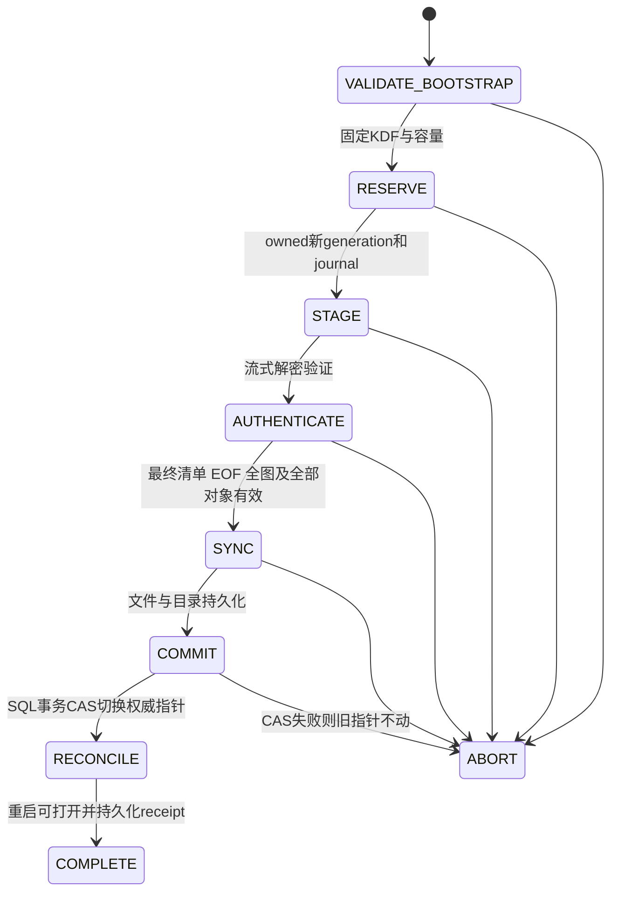

# 35 — 完整医疗备份候选格式与恢复状态机

2026-10-14，DESIGN_ONLY。没有正式新magic、格式writer/reader、实际跨设备恢复或生产备份修改。PNBAK1保持不变。合成模型不验证加密或真正掉电持久性。

## 两种明确选择

“只备份结构化记录”：继续PNBAK1，明确不含附件/关联/DEK。B1未来必须将导出serializationSchema固定9、字段表allowlist固定，而不是使用Room10 runtime version/SELECT*。新版本读旧schema1..9，保持现有Argon2id32MiB/t3/p1、magic、32MiB包/JSON、100k行、深度32等限制。旧app读取未来结构化包的兼容性须固定旧实现验收，B0不承诺未测兼容。

“完整备份医疗附件”：独立新magic/version、独立密码KDF和流式AEAD协议；包含现有DOMAIN_TABLES的28个结构化业务表及trash（不是复制Room内部表、device alias或reminderMapping；提醒映射按现有恢复路径重建）、临床identity登记、document/version/link/operation恢复证据、所有保留版本/垃圾箱原件、缺失状态，以及便携DEK包裹材料。设备Keystore私钥不导出；缺失或损坏对象不能悄悄忽略后宣称完整成功。允许用户另做结构化备份，完整备份失败必须清楚说明。

## 候选包结构（未冻结）

固定bounded bootstrap：magic(待分配)、protocol、suite、KDF profile ID、salt16、archiveUUID、固定长度wrap nonce12与随机master key包裹材料（ciphertext/tag16）。bootstrapUnsigned包含nonce及固定envelope长度，包裹ciphertext/tag自身排除；bootstrap总长候选≤1024B。未知套件/profile/超预算在分配KDF内存前拒绝；安全allowlist固定实际cost，不接受任意内存参数。明确定义bootstrapUnsigned为上述固定字段但**不含wrap ciphertext/tag及header authentication tag**，避免自引用。便携包裹AAD=独立固定portable-wrap域||bootstrapUnsigned；password-derived KEK解包得到随机master key后，独立HKDF header key认证bootstrapUnsigned||wrapEnvelope（不含header tag）。headerHash精确定义为SHA256(bootstrapUnsigned||wrapEnvelope||headerTag)，随后body/final的AAD绑定该值；header认证key派生只引用SHA256(bootstrapUnsigned)，不能再引用自身tag或body。固定编码与长度上限须后续向量冻结。每次新导出都新随机master key/盐/archiveUUID，失败不续用旧计数器。

外层顺序AEAD frames（候选≤256KiB单帧、总计数上限8192；实际移动容量待测；候选完整包总长≤512MiB、graph对象≤1000且每原件≤16MiB，恢复metadata/字符串/深度采用固定allowlist预算。总frame上限不是允许256GiB输入，实际总长预算优先拒绝），非final空frame拒绝，metadata以bounded pages打包而非每字段一个frame。nonce96bit计数器，不复用；候选body key≤8192次加密且总GHASH输入（内容+AAD+长度块）<2^26个128bit块，header/final key各一次；这不是完整安全概率证明，允许AAD上限1024B，实际字段编码和读取验证预算待专家冻结。HKDF备份header/body/final三个独立域，与对象/设备/便携wrap不同。AAD绑定协议headerHash、archiveUUID、frame index、类型、长度及逻辑record/object/version身份。固定类型：结构化表页、元数据页、便携key records、原件密文片段、最后manifest。结构化记录/关联/key材料全被外层AEAD加密认证；内层对象保留原始密文，不改AAD。实际格式另有独立key-domain/字节budget审核，不照搬对象256块限制。

final manifest认证：按序frame transcript digest、完整条目集合、每类计数、每对象cipher/hash/plain长度与版本、密钥域/handle列表、完整图边、legacy serialization schema、源logicalVault/recordEpoch、总字节与archiveUUID。所有声明和实际读取一致；严格EOF，无重复manifest/对象/frame、重排、缺少、尾随字节。不使用路径名还原目录、不允许zip slip/任意路径；不采用无界ZIP解压。frame层认证不替代最后集合认证；缺少final绝不能报告成功。

导出以受限SQL read snapshot确定全部记录+版本清单，snapshot前协调器确认没有未完成IMPORT/REPLACE/FULL_RESTORE，在短gate内固定已提交图和generation/version backup lease；包内只保留已完成/已中止历史操作证据，不能在新device恢复时复活源pending任务。随后释放gate，捕获rows期间仍以read snapshot固定一致视图，在该snapshot内将全部可变结构化rows、trash和attachment metadata分页冻结到独立SQLCipher加密spool（不是明文JSON/SQL），计入容量预约并提交spool seal；snapshot释放后只从这份冻结spool和lease固定的不可变密文导出。若无法完成spool则失败，不回读后来变化的live rows。spool key与owned journal关联，取消清理仅加密spool，进程death可reconcile。之后只读不可变密文。长复制不持UI/授权锁；所有读取受session取消令牌，退出/切空间阻止新的明文释放。内存仅固定frame缓冲、固定分页批次、受控KDF；manifest汇总以有界摘要/加密临时元数据分页，禁止把全备份明文拼到内存或磁盘。source changed不篡改既定snapshot，retained versions被lease保护。对象损坏/缺失/不可解包失败关闭输出，记录失败。

**成功条件同时满足**：final完全写入、精确EOF状态、SAF output成功close、未取消、local completion receipt持久化。close失败或最后写失败均不成功；系统云provider成功close不保证云端同步/永久保存，UI只陈述provider已接受。重新打开验证可作为明确的额外步骤，不能假装SAF提供原子远端rename。残缺外部密文可留给用户删除，绝无明文临时回退。

## 恢复：SQL权威指针最后切换

目标明确PRIMARY授权；新device保存源logicalVault/object/version/recordEpoch，创建本地physical generation、独立Keystore alias/envelopes。逻辑域原样保留为隔离store，不能仅改header UUID或换DEK使原密文冒充恢复。用户选择替换整个数据集合；不按integerID混合merge现有记录。不从包恢复AppLock密码/设备Keystore key或授权状态。

1. 先验证密码/header、预认证预算，创建durable operation及容量预约。保证旧数据+新staging同时有空间，不为恢复提前删除旧原件。
2. 每段认证后流式存owned加密对象，新metadata放独立SQLCipher staging库或新generation隔离表页；任何解密structured/key暂存都SQLCipher/加密文件，**不写明文SQL/JSON**。旧数据库保持可用但恢复激活时暂停写入；早期快照revision用于最后CAS，期间用户改动导致CAS拒绝或显式重新确认，不能覆盖。
3. 全包final/EOF/计数/对象原件hash/DEKhandle/typedtargetUUID/legacy数据/不可变ledger/clinicaltrash验证；被声明CORRUPT/MISSING的原件不能当VERIFIED。图校验按state区分：ACTIVE link需要currentEpoch/current typed live target；TRASHED通过现有trash snapshot证据，RETRACTED/QUARANTINED/PURGED引用稳定identity/tombstone，不要求已物理删除的临床live row重新出现，更不能将历史link自动改ACTIVE。整个必需图有效才进入激活。
4. 选用operation-owned O_CREAT|O_EXCL|O_NOFOLLOW独占创建对象并写加密bytes（对外保持STAGED/无引用），全认证后file+directory fsync成功，保存验证证据与journal。最后一个SQL事务安装完整图、修改generation pointer/recordEpoch/selected-version/operation=COMMITTED。不得先清旧DB再复制；不得由目录扫描自动发布cipher orphan。
5. commit后ack丢失：同operation UUID+archiveUUID+manifestdigest查询receipt，不重复新增。再次restore同archive时若当前dataset revision已变化，不能以旧receipt静默成功，应重新确认replace或拒绝；不支持未经设计的clone/merge。
6. 重启复核active generation和所有必需envelopes可打开，持久化COMPLETE；之前旧generation与key保留。cleanup失败仍保留待重试journal，不伪称清完。GC必须同generation引用/读/backup lease校验、durable intent、unlink+dirsync，不能按扩展名全盘删。

若采用整库文件替换：SQLCipher连接关闭、WAL checkpoint及db/-wal/-shm一致性、切换恢复的重复性需专门设计/实际验收；B0没实现这个方案，不以一条rename冒充原子DB+文件跨资源操作。推荐generation内图构建+权威pointer事务，具体Room adapter B3审查再冻结。

## 旧PNBAK1恢复与清空

验证旧包密码/表/ledger/trash成功之后，一个事务完成结构化替换、新随机recordEpoch、旧attachment links QUARANTINED、登记状态、generation/revision变化。所有旧原件/key保留隔离证据；相同lab/appointment整数ID不自动关联。覆盖import、RawData.clear、全部清空/重建空间也走同一hook，不仅restoreBackup。显式用户选择重新关联才建新identity/link，若跨logical vault须重新加密新对象，不能改旧AAD。

RawData.unguarded当前drop所有triggers，仅SchemaGuards重装；未来改为完整保护registry或经审查白名单且同事务finally reinstall，异常回滚/连接重开时验证完整名单+SQL。不取消SupplyLedger不可变保护。旧snapshot trash重插原ID时采用稳定recordUUID桥/证据检查，永久purge保留tombstone。详见报告34。

## 失败证据及剩余门槛

`backup_state_model.py`为纯内存**持久化模型假设**：crash丢volatile、不丢durable，SQL最后commit原子。14项测试（含多个子边界）验证预留/写入/认证/file sync/发布前dirsync/dirsync后的precommit失败不改旧数据；commit ack丢失重试、图缺失/重复/未认证/final/EOF/空间、lease GC、旧恢复epoch不自动关联、retired generation合法GC后reconcile、pending operation绑定archive+digest、后续用户修订阻断旧receipt、缺失active文件不伪造、备份close/cancel条件。AUTHENTICATED输入是模型假设，不实现新包加密。

真实断电、满盘ENOSPC、WAL/torn-write、硬件fsync/flash、进程death每边界、真实第二设备完整包、Keystore硬件异常、实际新格式攻击向量均NOT_RUN。B3要求真实合成SQLCipher+故障目录/磁盘配额/kill进程测试，真实设备/授权测试设备，不清除用户应用数据。新协议+backup组合需要独立专家审查，模型不替代它。

### Android发布原语的实际反例与替代

77e168e API26/29/35实测Os.link被应用沙箱拒绝EACCES，因此硬链接不能作为候选生产发布原语；
这不是可以skip的环境瑕疵。新的实验保留hardlink拒绝/无target/源不变断言，另独立验证公开
Os.open(O_CREAT|O_EXCL|O_NOFOLLOW)现有target EEXIST不覆盖、新对象写入/fsync、目录fsync及leaf nofollow。
新策略不需要把完整part硬链接或依赖Java ATOMIC_MOVE的覆盖语义：文件路径由随机objectUUID/owned操作确定，
直接独占创建cipher object，未完成或未SQL commit一律STAGED，普通查询/reader权限不能按目录发现它。
完整footer/tag/hash失败或崩溃不具有可用附件；完整cipher orphan也不能自动升READY。key/envelope和操作预约先持久化，
最终认证file+dirsync后SQL CAS作为授权发布。取消/陈旧CAS只留下可reconcile的owned密文。
祖先目录竞争、实际SQLCipher/fsync/kill仍需B2验证，这个替代设计没有降低认证、禁止覆盖或原数据保留要求。
