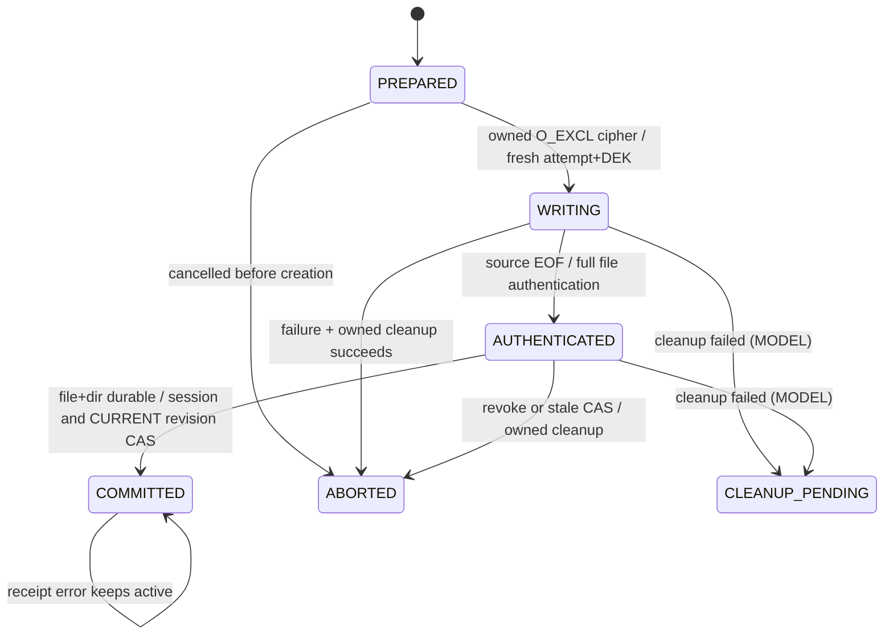

# 41 — B2-GATE 导入、读租约和失败合同

2026-10-14，TEST_ONLY。真实Tink cipher IO + 显式memory-CAS模型，不是正式Room附件仓库。所有测试合成数据；key清零不能证明JCA/native副本清除。

## API与B1接入映射

| 契约 | 本批/现有接口 | 正式接入缺口 |
| --- | --- | --- |
| ImportRequest | B2ImportSandbox source/Capability；SAF URI不持久化 | SAF临时授权、可信PRIMARY及用户元数据来源；B2另批 |
| ImportOperation | 随机operation/attempt/version、phase和8KiB流限额；AttachmentOperations.prepare/cancel已有真实B1 | 模型phase不与生产enum混淆；CLEANUP_PENDING为模型决策，正式可保留原phase+错误证据，新增字段需另审 |
| AuthenticatedObject | B2StreamingCandidate.Evidence length/plainHash/cipherHash，全部流认证至EOF | 正式必须可信SQL commitment，不可optional expected；本实验无正式格式 |
| ReadLease | 同FD scan→seek，Capability.fork，readAt/size/close | PRIMARY AppLock registry/ProxyFD/bitmap/backup/UI所有消费者还未接线 |
| Finalize | file force→directory seam→short Capability.publish(memoryCAS) | AttachmentTransaction.commit实际Room整同步commit门已B1；真实FS+Room journal后续B2 |
| Reconcile | active优先KEEP；complete orphan QUARANTINE；owned incomplete CLEANUP；foreign KEEP | 没有正式重启扫描/删除服务；必须持久日志和可信图，不扫目录自动READY |

DAO current/identity/pending固定CURRENT。AttachmentIdentity稳定typedUUID/epoch、Trash/tombstone及PNBAK旧恢复隔离、KeyFoundation角色接口均已B1验收，不能生造平行临床表。AttachmentSchema目前硬拒feature_enabled=1及VERIFIED/VALIDATED；未来批准B2写入即使默认关闭也需要**独立审核最小guard调整**。本批不放宽，test adapter不接真实DAO写有效附件。

## 状态与线性化

SQL commit是业务权威点，rename/file出现不是成功。耗时IO/全认证在授权monitor外；publish/撤权共用AttachmentSession monitor，发布先获得gate可完成；撤权先获得gate则拒后续提交。B1真实Room.runInTransaction返回含SQLitecommit，不能换成withTransaction最后一次check。读解密先到私有scratch，交付时gate重核；owner close撤销child；不能将完整native/UIRAM瞬间擦除作承诺。

## 可重复测试映射（结果见42最终HEAD）

| seam/风险 | 真实方法/证据级别 | 必须保持 |
| --- | --- | --- |
| 坏tail直接seek泄漏前部 | B2StreamingContract.corruptFinalSegmentCannotObtainAuthenticatedReader：首轮1/1 FAIL，修门后PASS | 无lease/无响应字节 |
| 空对象/边界/1与16MiB/超限 | Matrix.zeroOneBlockBoundariesOneAndSixteenMiBRoundTripAndSeek / sixteenMiBPlusOneExplicitlyRejected，真实AEAD | 空文件也认证EOF，超限拒绝而非截断 |
| 错key/domain/header/truncate/trailing/reorder/copy/missing | Matrix.truncatedTrailingReorderedCopiedMissingAndWrongDomainRejected，真实AEAD | 不交部分明文 |
| 旧合法tuple/同cryptoUUID新内容 | Matrix.validOlderCipherTupleFailsTrustedCommitment；b2_graph same_crypto模型 | 可信version及byte commitment，不靠公开hash |
| owner close/revoke/full认证前后 | Matrix.ownerCloseAndSessionRevokePreventExistingChildRead / revokeAfterCompleteAuthenticationBeforeLeaseRejects | 已持有reader不能交付原件 |
| 打开后块损坏 | Matrix.changedBlockAfterOpenIsReauthenticatedWithoutDelivery | 每读块重认证，不预判全文件持续完整 |
| 输入流中途异常/0progress/unknown length | B2Import.providerUnknownLengthErrorAndStallNeverPublish | 即使encryptor.close形成合法短stream也不得业务commit |
| WRITE/fsync/auth/dir/publish ENOSPC | B2Import.everyPrecommitFailureKeepsOldPointerAndCipher：真实file cipher，故障异常注入；非真实磁盘耗尽 | 原active/hash/revision不变，仅own资源清理 |
| cancel before/during/after auth | B2Import.revokeBeforeDuringAndAfterAuthenticationPreventsCommit | publish前撤权零业务副作用 |
| stale revision/重放/失败重试freshkey | B2Import.repeatedAttemptAndConcurrentStaleRevisionCannotOverwrite：memoryCAS竞争顺序模型；twoConcurrentImportersShareOneCasWinner真实双线程barrier后一胜一拒，DB仍是内存模型 | 已发布cipher不能覆盖，operation不能再执行 |
| cleanup失败/foreign/orphan | B2Import.cleanupFailureRetainsOwnedEvidenceAndForeignFiles | 保留可重试证据，foreign不删，complete orphan不激活 |
| commit后receipt失败 | B2Import.acknowledgementFailureAfterCommitDoesNotDeleteActive | 不用catch删已active文件，不再次扣quota或加版本 |
| MIME签名/假PDF/尺寸bomb | B2InputPolicyContract三项 | 签名只是候选，不是有效PDF/parser/机构真实性 |
| 20/100/1000图/缺节点/Trash/purge/旧epoch | test_b2_graph_contract五项，明确纯模型 | 历史links保留隔离，旧整数ID不自动认新目标 |
| Release隔离 | test_attachment_release_isolation注入27种DEX/manifest污染，实际APK扫描 | testcrypto/provider/magic/Tink不得进正式DEX |

原B1 Room9→10真实SQLCipher、同步commit竞态/旧PNBAK9/强停新PID三API及旧POC ProxyFD/SAF/Image实验继续完整运行；它们不是本批Tink正式FS+Room进口器验收。新B2密文写中实际force-stop/freshPID、真实ENOSPC、父目录替换、硬件掉电、正式restore writer **NOT_RUN/未实现**，不得用异常注入当真正满盘/掉电。

## B3恢复模型约束

所有Stage图验证source scopes、immutable crypto identities、version bytes、typedUUID/epoch；ACTIVE须真正live target，历史QUARANTINED/RETRACTED可指墓碑。旧PNBAK只记录，fresh dataset/epoch，链接全部隔离。target新devicealias/wrap与portable源crypto域不同，source devicewrapper不可直接AVAILABLE。完整包无最终清单/EOF、缺key/原件/retained version则不能成功；恢复失败保留旧CURRENT。图模型不会认证真实密文或实现跨库原子。
