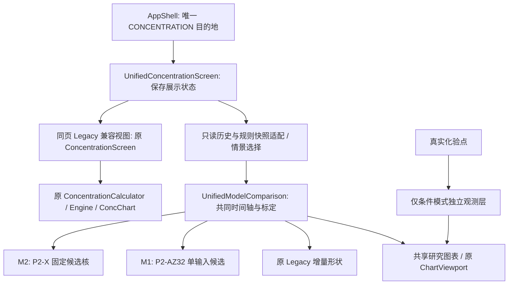

# 统一血药浓度：架构审计与验收（2026-10-11）

状态：工程改造、回归、设备、构建、体积及文档验收完成；`BRANCH_COMMITTED / PR_OPEN`，PR [#19](https://github.com/DevenirTwilight/HRT-Log/pull/19) 可进行工程合并审查，尚未合并到默认分支、未发布。默认基线f53726ff；PR1/2/3/17/18未合并，#3基于#2，#18基于#17；按文件复用，不整体merge、不修改其它PR。完整SHA及状态见[五PR实况](unified-concentration-pr-audit-2026-10.json)。M2默认是明确标注的研究展示，个人绝对浓度生产替换未放行。

## 实际架构及依赖

改造前：AppShell.CONCENTRATION → ConcentrationScreen → ConcentrationCalculator / ConcChart / ChartViewport；NotesViewModel持有conc和extra，Room仓库提供冻结记录/规则快照及labs。这些现有计算核及数据库不改。默认没有ExperimentalPkScreen、UnifiedConcentrationScreen或研究Kotlin核。

PR1 ResearchSublingualV01为15套P2-X固定M2参数的归一核。PR2只读ResearchHistoricalSlAdapter复用ConcentrationCalculator历史上下文门槛；ExperimentalPkScreen只是宿主。PR3 UnifiedConcentrationScreen → ExperimentalConcentrationComparison → ConcentrationModelComparison及StudyAnchors，ModelComparisonChart复用ChartViewport。其Legacy默认、缺M1、相对对比/Price独立幅度与实验入口不满足本次产品决定。

PR17 P2-AZ有32套手设网格M1、216套新网格M2，分别跨已见三研究留一选择；这不是P2-X冻结15或P2-V拟合。PR18按真实三研究计数并区分研究/个人预测用途，保留M2对M1的Rosano反例。此次不改变两PR研究结果/政策或宣称18/54项独立外测。

改造后：AppShell.CONCENTRATION → UnifiedConcentrationScreen → ExperimentalConcentrationComparison（只读audit/加载/情景选择）→ UnifiedModelComparison（M1/M2/Legacy共同标定与快照）→ ModelComparisonChart/原ChartViewport。Legacy兼容分支仍调用原ConcentrationScreen → ConcentrationCalculator/ConcChart/Engine。科研核不进入原正式个人预测引擎。

## 最终导航和保留范围

抽屉仍为原11目的地：日历、时间轴、就诊、历史、库存、药物、健康、**血药浓度**、化验、设置、关于。血药浓度 → UnifiedConcentrationScreen；默认M2研究条件曲线，M1候选可选，Legacy单选进入同页原历史视图。双模型/三模型叠加使用一个研究状态/计算快照/图表。Legacy原ConcentrationScreen、ConcChart及校准路径保留用于全部原途径，未重写为另一套科研页面。应用仍有兼容Legacy渲染器，不能声称整个项目只剩一个Canvas实现。

默认分支没有独立实验页面，故相对默认树没有删除旧页的D记录；相对未合并PR3，最终排除ExperimentalPkScreen、EXPERIMENTAL_PK导航、旧strings_experimental_pk.xml（96键×4语言）、两个独立debug预览Activity和冗余宿主测试。保留ResearchHistoricalSlAdapter与ExperimentalConcentrationComparison：前者只读历史/快照，后者统一数据加载与情景分离，名称不作为删除依据。科研源码、冻结输入、报告、历史偏离链、数据库/schema/用户记录和原Legacy数学全部保留。未合并或改写其它科研PR。

## 版本、选择规则、单位和标定

|模型/模式|实际版本和来源|显示规则及证据边界|
|---|---|---|
|M2|p2x-m2-research-v0.1；PR1/PR3复用的P2-X15条完整固定参数，来源40候选CSV|默认第一条p2x-14；允许明确选其它完整候选，范围仅15候选min/max，不是人体90%区间，无逐点中位合成模型|
|M1|p2az-m1-grid-v1；PR17 P2-AZ32网格候选JSON及设计|n=1/3/6/9、kf=4/8/12/16、ke=.4/1.2，w=0；手动候选而非唯一冻结正式赢家，不混入P2-V拟合或AZ216新M2|
|Legacy|0.1.0-literature-draft；原pk-params.json及Engine|原绝对历史算法/其它途径不变，不称已验证可靠标准。共同标定比较中的Legacy曲线是原增量响应归一形状，区别于原历史pg/mL视图|
|条件浓度|common-1mg-1h-v1；C=B+A×H|共同1mg/1h参考响应、同剂量历史/时间轴、B一次，示例B=25/A=100均人为，不取个人化验。pg/mL或×3.671pmol/L；AUC=B×时长+A×相对积分|
|Price1997人体研究情景|已追溯Figure1九个读图均值、Table1|固定研究1mg单剂，个人历史/化验/覆盖计数隔离。B取当前M2候选的明确基线假设（默认18），所有模型共同A=450−B（默认432）。Legacy tier2/10分钟为假设，非已核实研究含服时间；不是P2-X原每候选weightedfit或个人预测|
|相对比较|上述固定候选、共同1mg/1h协议|无量纲H；AUC单位relative·h。相同参考条件的精确逐时差异，不能称个人pg/mL差异|

Price图读0h为0时的梯形积分1557.5 pg·h/mL与Table1逐人去基线AUC均值2109±1031 pg·h/mL定义不同；UI显示两者并保留来源/定义差异，不为吻合修改参数。群体点误差条是读图宽度，不是受试者SD/CI。真实化验点只在条件情景单独显示、不参与B/A拟合；相对与研究群体模式不显示个人化验。原记录单位值不因pmol转换溢出被写改。

界面共同标定保证可视化数值可比，但不等于统计上公平的外部模型选择：P2-X M2已经拟合Price形状、AZ M1是候选网格，手动配对不能拿对Price的贴合宣布胜者。PR17跨研究留一的预设规则与Rosano反例保留在其研究报告，不推导个人临床优胜。

图表支持共同横纵轴、双/三模型、真实历史重复叠加/单剂、0–4/8/24h AUC、峰值/峰时、8/12/24h读数、精确内核点击、缩放平移和恢复。峰时及积分指标使用一分钟数值网格，点击不插值。15候选范围及8–24h尾部明确不代表人体覆盖率；阴影原判定包括没有此前合格剂量的时间，四语已注明。

## 保护协议及生产隔离

仅AppShell两处最小导航修改，独立commit4909b71。既有F1修复和历史状态不变，追加PD-2026-10-11-UNIFIED-CONCENTRATION，真实SHA为00f2c283… → 699f197d…（完整值见authorization及protected-file-hashes.json）；旧冻结baseline b8df023f…不改。当前用户明确授权本次单入口整合，授权不包含M2个人绝对生产替换。补丁为已实施的可审查差异，**不是等待批准或宣称未接线**。

check_protocol.py仍执行，精确校验授权字段/新hash/旧F1链，新增8项拒绝测试覆盖额外字节、缺失/伪造偏离、历史链、其它生产内核/图表/参数修改。没有关闭测试/降低PeriodStability断言/重写冻结协议。新research.py回放元数据修复原硬编码空偏离列表，记录真实链；旧报告和数学不改。其它保护文件SHA全不变。模型切换及只读Room路径不写历史/快照/设置；数据库schema未变。

## 仍不放行的个人绝对浓度替换

界面整合和带明确假设的pg/mL比较已可工程实现；研究归一形状拟合/已见研究留一不能直接证明个人绝对浓度。正式M2个人预测仍需可合法复现的独立未见完整人体时间序列及剂型、含服、实际时钟、assay元数据；预先锁定绝对B/A、唯一参数/模型选择规则和公平验证协议；个人标定、重复给药和8–24h尾部误差评估。已有跨研究证据可用，但用途边界不改变。研究分支提交与CI绿色不等于临床批准、默认分支合并或发布。

## 最终验收结果

应用源码：`001869b0c508c74b40bae0e6c6c85573e9c10cd6`；[CI38147885981](https://github.com/DevenirTwilight/HRT-Log/actions/runs/38147885981) JVM/Android/device三任务全部success，三artifact实际下载并校验SHA，见[ci-final-results.json](unified-acceptance/ci-final-results.json)。后续纯文档交接提交7f320aa的[CI38149469317](https://github.com/DevenirTwilight/HRT-Log/actions/runs/38149469317)三任务也success；应用/测试/工作流/输入的[源码树对象](unified-acceptance/validated-source-trees.json)与被测代码一致。最终报告追加仅改变文档与审计结果，不改应用或参数。

|实际执行|结果|范围/跳过说明|
|---|---|---|
|domain JVM|58/58通过|0失败/跳过|
|pk-engine JVM|114/114通过|Legacy、M1/M2、版本/参考、边界、叠加/精确点击/单位及压力|
|importer JVM|12/12通过|0失败/跳过|
|data JVM|72/72通过|旧schema/快照/数据路径|
|reminder JVM|14/14通过|0失败/跳过|
|app CI JVM/Robolectric|414总数、0失败、13跳过|12个原有可选视觉诊断+1个Robolectric无原生PdfDocument|
|app本地显式视觉全回归|414总数、0失败、1跳过|12诊断实际执行，24 native截图、无action_failed/measure_failed；不是自动断言所有布局无缺陷|
|最后化验极值专项|1/1通过|pg与pmol极大有限值在显示层排除，原记录保留；最终重新构建|
|Android API35 x86_64 data|14/14通过|真实模拟器instrumentation|
|Android API35 x86_64 app|67总数、0失败、2有意跳过|两个重启方法由独立prepare/verifyFreshProcess harness实际补跑通过|
|统一页设备三项|3/3通过，包含于app67|真实横→竖配置、recreate、M1/pmol/A200保持、对比点击及60剂压力|
|原生PDF设备|通过，包含于app67|PdfRenderer验证多语言长摘要与就诊报告页数/末页尺寸，补足Robolectric能力缺口|
|科研Python|264/264通过|含8项保护拒绝/链追溯；未降低原断言|
|PK审计Python / APK审计Python|13/13、3/3通过|原回放和ZIP审计|
|P2-X来源复现 / 性能采集防假绿|4/4、3/3通过|独立冻结输入；缺失/重复/错误文本/NaN/Infinity附件拒绝|
|M1独立参考/四语/模型源锁|通过|32×13参考，12项SHA、36键×4语言/占位符一致|
|Debug/unsigned Release/仪器编译|通过|只full版本、串行；默认和PR3也实际重建unsigned Release|
|Gradle lintFullDebug/Release vital|通过|最终fullDebug 0错误、134警告；没有禁用lint或隐藏警告|

[本地完整模块](unified-acceptance/full-test-results.json)、[显式视觉回归](unified-acceptance/final-app-test-results.json)、[最后专项](unified-acceptance/final-observation-test-results.json)、[命令/退出码](unified-acceptance/local-gradle-execution.json)、[Python](unified-acceptance/python-verification.json)、[设备](unified-acceptance/device-final-results.json)、[视觉测量](unified-acceptance/visual-audit.json)均为实际结果。源数据/参数冻结参考见unified-model-inputs/model-source-lock.json。CLI实际339合成profile回放及真实追加偏离链见[metadata摘录](unified-acceptance/research-replay-metadata.json)，clinical_accuracy_established/model_replacement_approved仍false。

性能：最后源码CI单次Debug模拟器60次剂量/约30天、2001点，计算 **4.106s**，进程PSS前 **221920KiB**、后 **225421KiB（220.14MiB）**；native/dalvik分类和限制见[原始JSON](unified-acceptance/unified-device-performance.json)。这是包括UI、仪器和GC的进程测量，不是曲线本身的增量RAM或帧率/Release/物理ARM结论；此前另一次2.788s只作阶段记录，不能拿不同CI宿主执行直接比较性能。计算在后台，图表点数有上限。JVM单次粗略堆测量2841.130ms/2001点，与AndroidPSS性质不同。

本地无KVM或连接手机，实际Android验证来自GitHub API35 x86_64模拟器；物理ARM设备、Release真机FPS/长时间内存未执行，不称通过。Release三包均unsigned、未签名发布；Debug/仪器使用项目原有公开测试key，没有接触私人签名材料。APK仅存执行工作区，未提交或上传。

四语三字体411dp×1800dp LIGHT native诊断保留24次测量，86个row记录是尺寸/布局测量而非自动判定缺陷；操作/测量异常0。模式选择已改为全宽可换行以修复小屏可达性。代表图：[法语字体2](unified-acceptance/visual/fr-rFR-font2-unified.png)、[繁中字体2](unified-acceptance/visual/zh-rTW-font2-unified.png)。缩放/平移/点击/恢复及实际旋转另有功能断言。

## 真实失败及修复记录

|阶段|真实结果|处置|
|---|---|---|
|android-initial|委托状态smart cast编译失败|先取局部不可变快照再访问；保留退出码1|
|android-retry1|恢复测试Compose API导入编译失败|使用项目现有junit4.StateRestorationTester；保留退出码1|
|android-retry2|专项16项中14通过、2失败|字符串断言改为实际完整文案；单位转换舍入比较用1e-12而不是Triple全等；顺序/时间/值断言保留，PeriodStability5/5原断言不变|
|android-focused-final|11/11通过|计算/化验/只读Room/UI/四语回归|
|full-tests|完整模块及app通过|原13项跳过逐一说明，12视觉诊断后续显式补跑；原生PDF由设备实现验证|
|设备8793209|Price切换后30s等待失败|核查为嵌套模式栏可见性，而非点击读数计算；未增加超时|
|设备71221ea|Price控件assertIsDisplayed失败|真实小屏发现，改全宽纵向可换行按钮，保留显示/选中断言|
|设备c6d3118|功能测试与重启harness通过；性能附件无效|AGP卸载后run-as错误被写成附件，CI绿色不作为PSS证据；改专用合成标签收集、严格JSON验证及3项防假绿测试|

旧失败日志退出码在local-gradle-execution.json，GitHub旧设备失败artifact已实际下载并SHA校验。本次没有关闭失败测试、降低PeriodStability断言、将性能采集错误算通过或用旧PR绿灯代替本轮。最终源码001869b及后续纯文档检查点三任务全部通过，三包实际构建及核验完成。

## 验收需求与实际覆盖

|需求|覆盖及限制|
|---|---|
|Legacy不变、其他药物/途径兼容|原Engine/Calculator/浓度页/ConcChart/参数SHA不变；pk114、原时期/给药回放及data迁移、只读Room路径；Legacy兼容视图继续使用原引擎|
|M1/M2版本/参考一致|源锁12项、32×13独立M1参考、原P2-X40输入与15固定候选一致性；候选手动选择不声明唯一赢家|
|共同时间轴/剂量、给药前后、叠加、精确点击|UnifiedModelComparisonTest和原ConcentrationModelComparisonTest；bg一次、多次叠加、before-dose、精确kernel；UI点击读数只在最终格式化时四舍五入|
|异常值/单位|NaN/Infinity/负数及有限极值导致AUC/pmol溢出均拒绝；化验溢出点仅显示层排除，原数据保留；极值pg纵轴headroom最后专项回归|
|UI模型/双三对比/实验入口清理|统一页UI6、NotesApp实际导航1、互斥/配对、共同单位；默认/PR3/最终目录审计，不新增独立路由|
|科研与个人观测区分|Price忽略个人events/origin/labs/审计计数；B/A明确人为或研究假设；相对无量纲、候选range非90%CI、Fig/Table冲突、尾部说明|
|缩放/平移/状态|UI触摸缩放和平移改变精确读取时间，保存状态恢复；Android活动recreate及实际横→竖配置切换保持M1/pmol/A200|
|多语言/字体|四语键和占位符一致；API35 native图形12组合×2页面=24截图，仅诊断而非全部布局断言；fr/繁中2倍字体代表图已保存|
|旧库/快照/加密/进程恢复|data JVM72及Android14；Room→repo→VM→adapter测试；真实重启harness补跑ordinary-suite两项有意跳过，确认新进程需验证且私有密文保留|
|PDF原生实现|Robolectric一项有意跳过；设备PdfRenderer实际验证长多语言摘要与就诊报告页数/最后页尺寸|
|性能/内存|60次合成剂量/30天，最多2001点；JVM粗略堆测量及Android单次Debug PSS/耗时，不作物理机/FPS/Release/临床指标；修复过AGP清理后的无效采集|
|构建/lint/APK|full Debug、unsigned full Release、仪器编译、lint；三固定源码基线同工具链/四ABI/裁剪/压缩实际量测；最后修复重新构建完成，实际结果见下表|
|协议保护|冻结lock/基线/证据原样；最小精确导航偏离及8项负向/追溯回归；不扩大其他保护文件豁免|

## 同环境APK、代码及资源前后对比

三源码的app/build.gradle.kts、proguard规则、根Gradle/settings/版本目录/gradle.properties SHA完全一致，见[配置哈希](unified-acceptance/build-configuration-hashes.json)。同Temurin21.0.12.1+1、Gradle9.3.1、AGP9.1.1、Kotlin2.2.20、SDK37/BT37.0.0；fullRelease、R8+资源裁剪、原生库压缩、通用四ABI、未签名。源码基线不同是比较对象，不是混用构建配置。

|构建源码|实际APK字节|十进制MB|
|---|---:|---:|
|默认f53726ff（仅旧正式页）|12,707,919|12.707919|
|旧PR3 4b264187（独立实验入口）|12,812,823|12.812823|
|统一页001869b|12,768,827|12.768827|

统一页相对默认 **+60,908B（+0.479%）**：默认原无研究页，新增功能成本；相对旧PR3 **-43,996B（-0.343%）**：已有实验方案整合后净减少。不能把后者称为从默认删除了原本不存在的页面。默认→统一压缩DEX+31,891B、资源表+28,964B，assets/res文件组不变。

[完整ZIP成员/CRC/SHA/分类审计](unified-acceptance/apk-size-audit.md)、[机器JSON](unified-acceptance/apk-size-audit.json)、[构建比较与SHA](unified-acceptance/apk-build-comparison.json)、[manifest/未签名核验](unified-acceptance/apk-manifest-signature-audit.json)。三包四ABI原生库CRC、压缩/原大小、压缩方式完全一致；包名net.plainnotes.app、version25/0.2.0、min26/target37、权限完全相同且无INTERNET。apksigner verify预期退出1/Missing META-INF/MANIFEST.MF，配合有效ZIP验证未签名，不把预期无签名算成构建失败。体积不代表运行RAM/安装展开或临床性能。

|运行源码/资源范围|默认|旧PR3|统一页|
|---|---:|---:|---:|
|app+pk主Kotlin文件|61|71|72|
|主Kotlin字节|587413|672178|668378|
|主Kotlin行|7668|9056|8960|
|app主XML字节|315781|357557|334526|
|研究UI文件|0|4|3|
|研究UI字节|0|43199|30439|
|旧独立资源键（4语总和）|0|384|0|
|统一资源键（4语总和）|0|0|144|

统计范围仅app/src/main+pk-engine/src/main Kotlin及app主资源XML，排除测试/debug/科研/docs/生成物；详见[source-resource-audit.json](unified-acceptance/source-resource-audit.json)。旧PR3→统一研究UI由4文件/43,199B变3文件/30,439B，整体主Kotlin少3,800B/96行，资源少23,031B，旧384键换统一144键。总体Kotlin文件因M1/共享标定新增而由71变72，不能声称整体文件数下降。科研报告和原Legacy均保留。

## 文件及GitHub交付

[完整实际修改列表](unified-acceptance/modified-files.txt)含全部路径和A/M状态。主要修改：AppShell两导航hunk；UnifiedConcentrationScreen/ExperimentalConcentrationComparison/ModelComparisonChart与只读ResearchHistoricalSlAdapter；新增M1Catalog/UnifiedModelComparison，复用ResearchSublingualV01/StudyAnchors/Comparison原核；四语36键资源；Room/UI/导航/观察/恢复/仪器/性能测试、源锁/独立参考/严格性能采集脚本；精确协议guard/偏离/8测试；CI及REQUIREMENTS §59/HANDOFF/验收证据。默认树没有旧实验组件，所以文件列表没有虚构D删除记录；不纳入旧PR3组件的范围与保留理由见前文。

PR：https://github.com/DevenirTwilight/HRT-Log/pull/19 。代码验收提交：[001869b0c508c74b40bae0e6c6c85573e9c10cd6](https://github.com/DevenirTwilight/HRT-Log/commit/001869b0c508c74b40bae0e6c6c85573e9c10cd6)，独立受保护导航提交4909b71，非保护首轮通过提交d3a6533。其后仅文档/报告；最终交付SHA见PR head及git log（文档不能写入自身尚未生成的提交SHA）。HANDOFF顶部记录当前状态，原阶段原文移入implementation-history.md，原科研交接全文/协议链仍保留。

**可合并**：单页导航、带清晰用途标注的研究/条件浓度可视化及兼容；当前任务已授权最小导航并登记真实SHA，不存在被冒称完成的待批准导航补丁。**仍不放行**：M2个人绝对浓度生产替换；上述独立证据缺口不阻塞界面整合。未自动merge、未正式投产、未签名发布。
