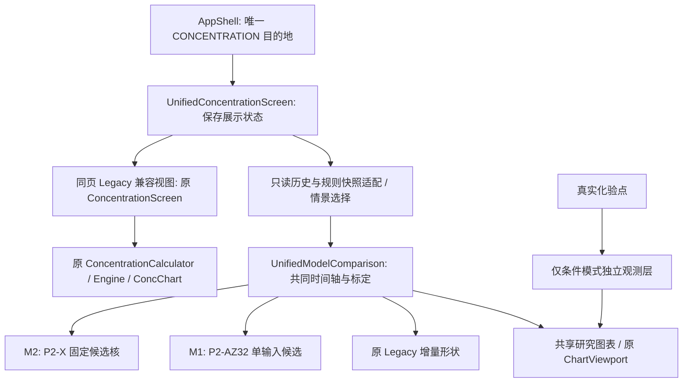

# 统一血药浓度：架构审计与验收（2026-10-11）

状态：工程已实际接线；最终设备/体积验收正在收尾，PR #19 尚为Draft、未合并。默认基线f53726ff；PR1/2/3/17/18未合并，#3基于#2，#18基于#17；按文件复用，不整体merge。实际PR状态及完整SHA见unified-concentration-pr-audit-2026-10.json。

## 实际架构及依赖

改造前：AppShell.CONCENTRATION → ConcentrationScreen → ConcentrationCalculator / ConcChart / ChartViewport；NotesViewModel持有conc和extra，Room仓库提供冻结记录/规则快照及labs。这些现有计算核及数据库不改。默认没有ExperimentalPkScreen、UnifiedConcentrationScreen或研究Kotlin核。

PR1 ResearchSublingualV01为15套P2-X固定M2参数的归一核。PR2只读ResearchHistoricalSlAdapter复用ConcentrationCalculator历史上下文门槛；ExperimentalPkScreen只是宿主。PR3 UnifiedConcentrationScreen → ExperimentalConcentrationComparison → ConcentrationModelComparison及StudyAnchors，ModelComparisonChart复用ChartViewport。其Legacy默认、缺M1、相对对比/Price独立幅度与实验入口不满足本次产品决定。

PR17 P2-AZ有32套手设网格M1、216套新网格M2，分别跨已见三研究留一选择；这不是P2-X冻结15或P2-V拟合。PR18按真实三研究计数并区分研究/个人预测用途，保留M2对M1的Rosano反例。此次不改变两PR研究结果/政策或宣称18/54项独立外测。

改造后：AppShell.CONCENTRATION → UnifiedConcentrationScreen → ExperimentalConcentrationComparison（只读audit/加载/情景选择）→ UnifiedModelComparison（M1/M2/Legacy共同标定与快照）→ ModelComparisonChart/原ChartViewport。Legacy兼容分支仍调用原ConcentrationScreen → ConcentrationCalculator/ConcChart/Engine。科研核不进入原正式个人预测引擎。

## 最终导航和保留范围

抽屉仍为原11目的地：日历、时间轴、就诊、历史、库存、药物、健康、**血药浓度**、化验、设置、关于。血药浓度 → UnifiedConcentrationScreen；默认M2研究条件曲线，M1候选可选，Legacy单选进入同页原历史视图。双模型/三模型叠加使用一个研究状态/计算快照/图表。Legacy原ConcentrationScreen、ConcChart及校准路径保留用于全部原途径，未重写为另一套科研页面。应用仍有兼容Legacy渲染器，不能声称整个项目只剩一个Canvas实现。

默认分支没有独立实验页面，故相对默认树没有删除旧页的D记录；相对未合并PR3，最终排除ExperimentalPkScreen、EXPERIMENTAL_PK导航、旧strings_experimental_pk.xml（96键×4语言）、两个独立debug预览Activity和冗余宿主测试。保留ResearchHistoricalSlAdapter与ExperimentalConcentrationComparison：前者只读历史/快照，后者统一数据加载与情景分离，名称不作为删除依据。科研源码、冻结输入、报告、历史偏离链、数据库/schema/用户记录和原Legacy数学全部保留。未合并或改写其它科研PR。

## 版本、选择规则、单位和标定

|模型/模式|实际版本和来源|显示规则及证据边界|
|---|---|---|
|M2|p2x-m2-research-v0.1；PR1/PR3复用的P2-X15条完整固定参数，来源40候选CSV|默认第一条p2x-14；允许明确选其它完整候选，范围仅15候选min/max，不是人体90%区间，无逐点中位合成模型|
|M1|p2az-m1-grid-v1；PR17 P2-AZ32网格候选JSON及设计|n=1/3/6/9、kf=4/8/12/16、ke=.4/1.2，w=0；手动候选而非唯一冻结正式赢家，不混入P2-V拟合或AZ216新M2|
|Legacy|0.1.0-literature-draft；原pk-params.json及Engine|原绝对历史算法/其它途径不变，不称已验证可靠标准。共同标定比较中的Legacy曲线是原增量响应归一形状，区别于原历史pg/mL视图|
|条件浓度|common-1mg-1h-v1；C=B+A×H|共同1mg/1h参考响应、同剂量历史/时间轴、B一次，示例B=25/A=100均人为，不取个人化验。pg/mL或×3.671pmol/L；AUC=B×时长+A×相对积分|
|Price1997人体研究情景|已追溯Figure1九个读图均值、Table1|固定研究1mg单剂，个人历史/化验/覆盖计数隔离。B取当前M2候选的明确基线假设（默认18），所有模型共同A=450−B（默认432）。Legacy tier2/10分钟为假设，非已核实研究含服时间；不是P2-X原每候选weightedfit或个人预测|
|相对比较|上述固定候选、共同1mg/1h协议|无量纲H；AUC单位relative·h。相同参考条件的精确逐时差异，不能称个人pg/mL差异|

Price图读0h为0时的梯形积分1557.5 pg·h/mL与Table1逐人去基线AUC均值2109±1031 pg·h/mL定义不同；UI显示两者并保留来源/定义差异，不为吻合修改参数。群体点误差条是读图宽度，不是受试者SD/CI。真实化验点只在条件情景单独显示、不参与B/A拟合；相对与研究群体模式不显示个人化验。原记录单位值不因pmol转换溢出被写改。

界面共同标定保证可视化数值可比，但不等于统计上公平的外部模型选择：P2-X M2已经拟合Price形状、AZ M1是候选网格，手动配对不能拿对Price的贴合宣布胜者。PR17跨研究留一的预设规则与Rosano反例保留在其研究报告，不推导个人临床优胜。

图表支持共同横纵轴、双/三模型、真实历史重复叠加/单剂、0–4/8/24h AUC、峰值/峰时、8/12/24h读数、精确内核点击、缩放平移和恢复。峰时及积分指标使用一分钟数值网格，点击不插值。15候选范围及8–24h尾部明确不代表人体覆盖率；阴影原判定包括没有此前合格剂量的时间，四语已注明。

## 保护协议及生产隔离

仅AppShell两处最小导航修改，独立commit4909b71。既有F1修复和历史状态不变，追加PD-2026-10-11-UNIFIED-CONCENTRATION，真实SHA为00f2c283… → 699f197d…（完整值见authorization及protected-file-hashes.json）；旧冻结baseline b8df023f…不改。当前用户明确授权本次单入口整合，授权不包含M2个人绝对生产替换。补丁为已实施的可审查差异，**不是等待批准或宣称未接线**。

check_protocol.py仍执行，精确校验授权字段/新hash/旧F1链，新增8项拒绝测试覆盖额外字节、缺失/伪造偏离、历史链、其它生产内核/图表/参数修改。没有关闭测试/降低PeriodStability断言/重写冻结协议。新research.py回放元数据修复原硬编码空偏离列表，记录真实链；旧报告和数学不改。其它保护文件SHA全不变。模型切换及只读Room路径不写历史/快照/设置；数据库schema未变。

## 仍不放行的个人绝对浓度替换

界面整合和带明确假设的pg/mL比较已可工程实现；研究归一形状拟合/已见研究留一不能直接证明个人绝对浓度。正式M2个人预测仍需可合法复现的独立未见完整人体时间序列及剂型、含服、实际时钟、assay元数据；预先锁定绝对B/A、唯一参数/模型选择规则和公平验证协议；个人标定、重复给药和8–24h尾部误差评估。已有跨研究证据可用，但用途边界不改变。研究分支提交与CI绿色不等于临床批准、默认分支合并或发布。

## 验收证据索引（最终更新中）

完整模块首轮：[full-test-results.json](unified-acceptance/full-test-results.json)。domain58、pk114、importer12、data72、reminder14均0失败/0跳过；app414、0失败、13原有跳过。后续显式启用ButtonAudit的全app414、0失败、1原生PDF跳过，12视觉诊断实际执行（24PNG）；最终布局/极值校验修复后正在再次执行。PDF的真实Android实现另由原WellbeingAndroidTest覆盖；非物理设备验证。

科研Python264/264（含保护拒绝8）、PK审计13/13、APK审计3/3、P2-X复现4/4、M1独立32×13参考和四语源锁均通过。真实CLI339合成profile回放带实际偏离链，clinical_accuracy_established及model_replacement_approved仍false。见python-verification.json、research-replay-metadata.json、local-gradle-execution.json、protected-file-hashes.json。

已通过第一轮Debug/unsigned Release/仪器编译/lint；最终同源再构建和三基线APK量测尚未完成，不能提前填入旧APK大小。API35 x86_64 CI前两轮失败已保留：8793209切换Price后超时，71221ea明确display-STUDY不可见；已改成全宽纵向模式控件，不延长超时/跳过断言。c6d3118的功能设备测试已通过：data14、app67（普通套件有2个重启方法跳过，独立harness实际补跑成功）。其PSS附件为AGP卸载后run-as错误文本，故性能采集无效；修正采集并加3项防假绿测试，最新6c5fc72的旋转/有效PSS设备及Android正在运行。JVM及264项科研检查已通过。

本地无KVM/连接手机。API35模拟器、活动recreate、存储迁移与进程重启harness是实际Android验证；物理ARM设备、Release真机FPS/长时间内存和发布签名未执行，不冒充验收。Release始终unsigned；未使用私人key、未上传或发布APK。

实际修改列表：[modified-files.txt](unified-acceptance/modified-files.txt)。源码/资源前后统计：[source-resource-audit.json](unified-acceptance/source-resource-audit.json)，最终布局修复后的数值待更新。GitHub PR：https://github.com/DevenirTwilight/HRT-Log/pull/19 。

## 真实失败及修复记录

|阶段|真实结果|处置|
|---|---|---|
|android-initial|委托状态smart cast编译失败|先取局部不可变快照再访问；保留退出码1|
|android-retry1|恢复测试Compose API导入编译失败|使用项目现有junit4.StateRestorationTester；保留退出码1|
|android-retry2|专项16项中14通过、2失败|字符串断言改为实际完整文案；单位转换舍入比较用1e-12而不是Triple全等；顺序/时间/值断言保留，PeriodStability5/5原断言不变|
|android-focused-final|11/11通过|计算/化验/只读Room/UI/四语回归|
|full-tests|完整模块及app通过|原13项跳过逐一说明，12视觉诊断后续显式补跑；原生PDF由设备实现验证|
|设备8793209|Price切换后30s等待失败|核查为嵌套模式栏可见性，而非点击读数计算；未增加超时|
|设备71221ea|Price控件assertIsDisplayed失败|真实小屏发现，改全宽纵向可换行按钮，保留显示/选中断言|
|设备c6d3118|功能测试与重启harness通过；性能附件无效|AGP卸载后run-as错误被写成附件，CI绿色不作为PSS证据；改专用合成标签收集、严格JSON验证及3项防假绿测试|

旧失败日志退出码在local-gradle-execution.json，GitHub旧设备失败artifact已实际下载并SHA校验。本次没有关闭失败测试、降低PeriodStability断言、将性能采集错误算通过或用旧PR绿灯代替本轮。最终设备、体积和报告待补齐实际结果。

## 验收需求与实际覆盖

|需求|覆盖及限制|
|---|---|
|Legacy不变、其他药物/途径兼容|原Engine/Calculator/浓度页/ConcChart/参数SHA不变；pk114、原时期/给药回放及data迁移、只读Room路径；Legacy兼容视图继续使用原引擎|
|M1/M2版本/参考一致|源锁12项、32×13独立M1参考、原P2-X40输入与15固定候选一致性；候选手动选择不声明唯一赢家|
|共同时间轴/剂量、给药前后、叠加、精确点击|UnifiedModelComparisonTest和原ConcentrationModelComparisonTest；bg一次、多次叠加、before-dose、精确kernel；UI点击读数只在最终格式化时四舍五入|
|异常值/单位|NaN/Infinity/负数及有限极值导致AUC/pmol溢出均拒绝；化验溢出点仅显示层排除，原数据保留；极值pg纵轴headroom最后专项回归|
|UI模型/双三对比/实验入口清理|统一页UI6、NotesApp实际导航1、互斥/配对、共同单位；默认/PR3/最终目录审计，不新增独立路由|
|科研与个人观测区分|Price忽略个人events/origin/labs/审计计数；B/A明确人为或研究假设；相对无量纲、候选range非90%CI、Fig/Table冲突、尾部说明|
|缩放/平移/状态|UI触摸缩放和平移改变精确读取时间，保存状态恢复；Android活动recreate及实际横→竖配置切换保持M1/pmol/A200|
|多语言/字体|四语键和占位符一致；API35 native图形12组合×2页面=24截图，仅诊断而非全部布局断言；fr/繁中2倍字体代表图已保存|
|旧库/快照/加密/进程恢复|data JVM72及Android14；Room→repo→VM→adapter测试；真实重启harness补跑ordinary-suite两项有意跳过，确认新进程需验证且私有密文保留|
|PDF原生实现|Robolectric一项有意跳过；设备PdfRenderer实际验证长多语言摘要与就诊报告页数/最后页尺寸|
|性能/内存|60次合成剂量/30天，最多2001点；JVM粗略堆测量及Android单次Debug PSS/耗时，不作物理机/FPS/Release/临床指标；修复过AGP清理后的无效采集|
|构建/lint/APK|full Debug、unsigned full Release、仪器编译、lint；三固定源码基线同工具链/四ABI/裁剪/压缩实际量测；最后修复重新构建后填入结果|
|协议保护|冻结lock/基线/证据原样；最小精确导航偏离及8项负向/追溯回归；不扩大其他保护文件豁免|

